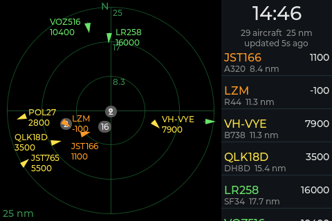

# adsb-monitor

A desk radar for planes around you, on the Freenove FNK0104S (ESP32-S3 with a 4.0 inch
320x480 IPS touch screen). It fetches aircraft positions from a free online ADS-B
aggregator ([adsb.fi](https://adsb.fi) by default) over Wi-Fi, or from your own
receiver on the local network.



## What it shows

The screen is landscape:

- **Radar (left):** you're in the middle, north is up, and there are three range
  rings with their distance in nautical miles. Each plane is a small arrow
  pointing the way it's flying, with its callsign and altitude next to it. A
  fading trail shows where it's been. The colour shows the altitude:
  - grey: on the ground
  - orange: below 2,000 ft
  - yellow: below 10,000 ft
  - green: below 20,000 ft
  - blue: below 30,000 ft
  - purple: 30,000 ft and above
  - red: the plane is squawking an emergency

  Altitudes above 18,000 ft are shown as flight levels, for example FL350.
- **Clock and status (top right):** the time, how many aircraft are in range, and how
  long ago the data was updated. This turns red with STALE if the last update failed.
- **List (right):** the nearest 30 aircraft, nearest first.

Touch:

- **Tap a plane or a list row** to see its details: registration, type, altitude,
  climb or descent rate, speed, track, distance and bearing, squawk, and ICAO hex.
  Tap the details to go back.
- **Tap an empty part of the radar** to zoom in to ½ or ¼ of the range. Another tap
  takes it back to full range.

## First start

1. Power the board from its USB-C port.
2. The screen says to set up Wi-Fi with the ESP-Touch app.
3. Use the ESP-Touch app on your phone (version 2) to send your Wi-Fi name and password.
4. The monitor joins Wi-Fi, sets the clock and starts fetching aircraft.

To set up Wi-Fi again, unplug the board, plug it back in, then hold the **BOOT**
button for 3 seconds within the first minute.

## Settings page

Open `http://adsb/` or `http://adsb.mianos.com/`. You can change:

- the network name
- screen brightness
- time zone
- your location, and the radius to show (1 to 250 nm)
- where the data comes from (see [Data providers](#data-providers))

Changing the network name restarts the monitor. Every other change applies
straight away. The page also lists the aircraft currently in range.

The same settings as JSON:

```sh
curl http://adsb.mianos.com/config
curl -X POST -d '{"radius_nm":40}' http://adsb.mianos.com/config
curl http://adsb.mianos.com/aircraft
curl -o screen.bmp http://adsb.mianos.com/screenshot   # what the display shows now
```

## Data providers

The **Provider** menu picks an entry from the **Providers (JSON)** table on the
settings page. You can edit the table there: change a URL, add an entry, or add an
API key. The default table:

```json
{
 "adsb.fi":  {"url": "https://opendata.adsb.fi/api/v2/lat/{lat}/lon/{lon}/dist/{nm}", "poll_s": 5},
 "adsb.lol": {"url": "https://api.adsb.lol/v2/point/{lat}/{lon}/{nm}", "poll_s": 180},
 "local":    {"url": "http://readsb.local/data/aircraft.json", "poll_s": 1}
}
```

- `url`: `{lat}`, `{lon}` and `{nm}` are replaced with your location and radius.
  The response can list aircraft under `ac` or `aircraft`, as readsb-style services do.
- `poll_s`: seconds between requests, 1 to 3600 (default 5).
- `headers`: optional extra request headers, for example `{"api-auth": "your key"}`.

Notes:

- adsb.lol allows 500 requests a day without a key, which is why its entry polls
  every 3 minutes.
- For your own receiver, point `local` at its readsb `aircraft.json`, for example
  `http://192.168.1.50/data/aircraft.json`. Aircraft outside your radius are dropped.
- HTTPS certificates are checked against the built-in CA bundle.
- Saving is refused if the JSON is invalid, an entry has no `url`, or the chosen
  provider isn't in the table.
- Headers, including API keys, are stored on the board and shown to anyone on your
  network who opens the settings page or `/config`.

To switch from the command line:

```sh
curl -X POST -d '{"provider":"local"}' http://adsb.mianos.com/config
```

## Building

ESP-IDF v6.0.1. `./build.sh` builds the firmware, `./build.sh flash` builds and
flashes it over USB, and `./build.sh monitor` also shows the log. The USB port
defaults to `/dev/cu.usbmodem142101`; set `PORT` to use another.

After the first USB flash, updates can go over Wi-Fi:

```sh
curl --data-binary @build/adsb-monitor.bin http://adsb.mianos.com/firmware
```

If a new firmware doesn't get onto Wi-Fi within 2 minutes, the board goes back to
the previous firmware.

Other endpoints: `GET /healthz`, `GET /log` (`?prev` for the previous boot), `POST /reboot`.

## Hardware notes

The pins come from Freenove's own TFT_eSPI setup file and sample sketches
([Freenove_ESP32_S3_Display](https://github.com/Freenove/Freenove_ESP32_S3_Display)):

| Part | Pins |
|---|---|
| ST7796 LCD (SPI, 80 MHz) | MOSI 11, SCLK 12, CS 10, DC 46, backlight 45, no reset |
| FT6336U touch (I2C) | SDA 16, SCL 15, RST 18, INT 17 (not used) |
| BOOT key | 0 |

The chip is an ESP32-S3R8, with 8 MB of octal PSRAM and 16 MB of flash. The shared
infrastructure comes from [mianesp](https://github.com/mianos/mianesp): Wi-Fi
provisioning, the web server, settings and NVS. Two of its parts aren't used:

- mianesp's `button` component has the same name as the one Espressif's
  `esp_lvgl_port` looks for, so this project drives LVGL directly.
- mianesp's `HttpClient` doesn't check HTTPS certificates, so the HTTPS fetch is
  done in `Feed.cpp`.
